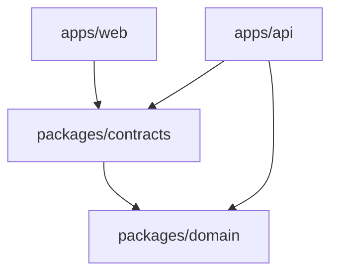
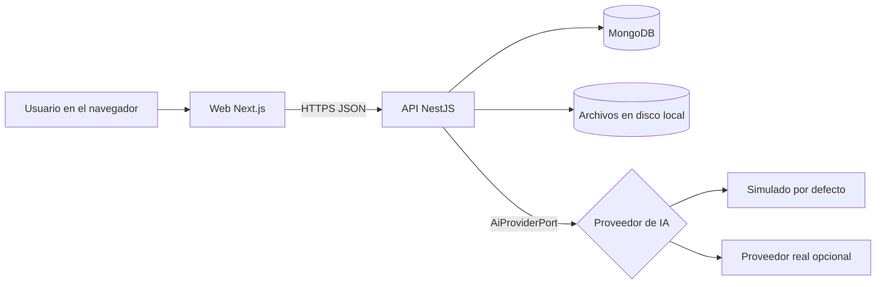
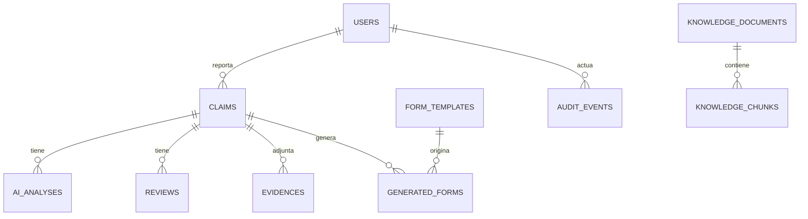

# Architecture Spine — INSURE AI

## Design Paradigm

Monolito modular con arquitectura hexagonal: un único backend desplegable (NestJS) dividido en módulos de negocio; el dominio no conoce frameworks ni infraestructura; el acceso a base de datos, IA, archivos y PDF ocurre mediante puertos con adaptadores intercambiables. La web (Next.js) es un cliente del mismo API; una futura app móvil lo sería también.

| Capa | Ubicación | Contenido |
| --- | --- | --- |
| Dominio | `packages/domain` | Reglas puras: estados del Expediente, validación de transiciones, cálculo de campos corregidos |
| Contratos | `packages/contracts` | Esquemas Zod y tipos compartidos por API y web, incluido `ExtractionV1` |
| Aplicación | `apps/api/src/<módulo>/application` | Casos de uso, orquestación, autorización por propiedad |
| Adaptadores | `apps/api/src/<módulo>/infrastructure` | Mongo, proveedores de IA, almacenamiento, generador de PDF |
| Interfaz HTTP | `apps/api/src/<módulo>/http` | Controladores, guards, DTOs |
| Cliente | `apps/web` | Next.js; consume el API mediante los contratos |

## Invariants & Rules



Dependencias permitidas: solo en el sentido de las flechas. `packages/domain` no importa a nadie. La web no importa del API.

### AD-1 — Un solo backend modular

- **Binds:** all
- **Prevents:** microservicios y servicios sueltos que multiplican despliegue y coordinación
- **Rule:** el API es un único proceso NestJS con módulos `identity`, `claims`, `ai`, `evidence`, `forms`, `knowledge` y `audit`. Un módulo solo usa a otro por su servicio exportado, nunca por sus modelos de base de datos.

### AD-2 — El dominio es puro

- **Binds:** FR-6, FR-13, FR-14, FR-16
- **Prevents:** reglas de negocio dispersas en controladores o en la base de datos
- **Rule:** las reglas de estados y validación viven en `packages/domain` sin dependencias de NestJS, Mongoose ni HTTP. Tienen pruebas unitarias propias.

### AD-3 — La autorización se decide en el backend

- **Binds:** FR-1, FR-2, FR-3, FR-19, FR-27
- **Prevents:** permisos que dependen de ocultar botones en la interfaz
- **Rule:** todo endpoint está protegido por un guard que exige autenticación y un permiso por rol (denegar por defecto). Las reglas "solo lo propio" para el Reportante se aplican en la capa de aplicación. La matriz de `modelo-datos-contratos-rbac.md` es la fuente de verdad y cada fila tiene prueba positiva y negativa.

### AD-4 — La IA solo entra por un puerto

- **Binds:** FR-8..FR-13
- **Prevents:** acoplar el dominio a un proveedor, y que el demo dependa de una clave
- **Rule:** el módulo `ai` expone `AiProviderPort`. Existen dos adaptadores: `SimulatedProvider` (por defecto) y un proveedor real opcional, elegido por la variable de entorno `AI_PROVIDER`. La clave se lee del entorno. Los prompts y los esquemas llevan número de versión.

### AD-5 — La salida de la IA se valida y nunca es definitiva

- **Binds:** FR-8, FR-12, FR-13, FR-14, FR-16, FR-21
- **Prevents:** datos inventados que pasan al Expediente o al PDF sin revisión
- **Rule:** toda salida de la IA se valida contra `ExtractionV1`; si no valida, se descarta, se registra el error y el Expediente no cambia. La Propuesta de IA se guarda en su propia colección (`ai_analyses`) y no modifica el Expediente. Los datos que alimentan el PDF salen solo de los datos validados por un Revisor. El esquema no contiene campos de cobertura, responsabilidad, causalidad ni diagnóstico. El nivel de incertidumbre es ordinal (baja, media, alta), no una probabilidad.

### AD-6 — La Auditoría es de solo adición

- **Binds:** FR-26, FR-27
- **Prevents:** perder trazabilidad o poder alterarla
- **Rule:** todo cambio de Estado, de usuario o de rol, toda Propuesta, corrección, validación, descarga de Evidencia y generación de Formulario pasa por `AuditService`. No existe ningún endpoint ni método para editar o borrar Eventos de auditoría. Cada petición recibe un `correlationId` que viaja en los logs y en los eventos.

### AD-7 — Los contratos se definen una vez

- **Binds:** all
- **Prevents:** que web y API discrepen sobre la forma de los datos
- **Rule:** los esquemas Zod de `packages/contracts` son la fuente de los tipos y de la validación de entrada del API y de los formularios de la web. Un cambio incompatible crea una versión nueva del esquema (`v2`); no se edita la anterior.

### AD-8 — Los archivos pasan por un puerto de almacenamiento

- **Binds:** FR-17, FR-18, FR-19
- **Prevents:** binarios en MongoDB y enlaces públicos a archivos
- **Rule:** `StoragePort` guarda los archivos; el adaptador del MVP escribe en disco local (`storage/`, fuera del repositorio). MongoDB guarda solo metadatos y hash. La descarga se hace únicamente por un endpoint autenticado y autorizado, que registra un Evento de auditoría. El tipo de archivo se valida por contenido, no solo por extensión.

### AD-9 — El procesamiento de IA es síncrono y visible

- **Binds:** FR-8, FR-9, FR-10
- **Prevents:** infraestructura de colas antes de que haga falta
- **Rule:** al enviar el Reporte, la llamada a la IA se hace dentro de la petición con tiempo máximo configurable y el Expediente muestra un Estado de procesamiento. El caso de uso se escribe de modo que pueda pasar a una cola sin cambiar el contrato.

### AD-10 — Datos sintéticos y secretos fuera del repositorio

- **Binds:** all
- **Prevents:** exposición de datos reales o claves
- **Rule:** solo existen datos sintéticos (semillas y Casos sintéticos). Toda configuración secreta se lee del entorno, validada al arrancar; el repositorio contiene `.env.example` y nunca `.env`. Ningún dato real se envía a un servicio externo de IA.

### AD-11 — El Estado del Expediente es una máquina de estados

- **Binds:** FR-6, FR-16
- **Prevents:** transiciones arbitrarias y validaciones sin permiso
- **Rule:** las transiciones válidas están definidas en `packages/domain` (tabla en `modelo-datos-contratos-rbac.md`). Cualquier otra se rechaza. Solo un Revisor o un Administrador puede fijar "validado por responsable".

## Consistency Conventions

| Concern | Convention |
| --- | --- |
| Naming (entities, files, interfaces, events) | Archivos en `kebab-case`; clases y tipos en `PascalCase`; variables en `camelCase`; colecciones de Mongo en `snake_case` plural; acciones de auditoría con formato `entidad.accion` (por ejemplo `claim.validated`) |
| Data & formats (ids, dates, error shapes, envelopes) | Identificadores como cadenas (ObjectId de Mongo); fechas ISO 8601 en UTC; errores con la forma `{ code, message, details?, correlationId }`; listas con paginación `{ items, page, pageSize, total }`; versiones de esquema en el campo `schemaVersion` |
| State & cross-cutting (mutation, errors, logging, config, auth) | Sesión con JWT de vida corta en cookie `httpOnly`; contraseñas con hash; configuración leída del entorno y validada al arrancar; logs JSON con `correlationId`; los errores de dominio se mapean a códigos HTTP en un solo filtro |
| Idioma | Interfaz y documentación en español; identificadores de código en inglés |

## Stack

La versión exacta de cada dependencia la fija el archivo de bloqueo (`pnpm-lock.yaml`) al crear el esqueleto; no se usa `latest`. La columna "Verificación" indica qué se comprobó al redactar.

| Name | Versión | Verificación |
| --- | --- | --- |
| Node.js | 24 LTS (en el equipo de desarrollo: v24.11.1) | Verificada en el equipo |
| Gestor de paquetes | pnpm, versión fijada en `packageManager` | Por confirmar al instalar |
| TypeScript | 5.x | Por confirmar al instalar |
| Next.js | línea 16.x | Línea comprobada en fuentes públicas; patch por fijar |
| React | 19.x | Por confirmar al instalar |
| NestJS | 11.x | Por confirmar al instalar |
| MongoDB | 8.x | Por confirmar al instalar |
| Mongoose | 8.x | Por confirmar al instalar |
| Zod | línea estable vigente | Por confirmar al instalar |
| Vitest | línea estable vigente | Por confirmar al instalar |
| Playwright | línea estable vigente | Por confirmar al instalar |
| Generación de PDF | `pdf-lib` | Por confirmar al instalar |
| Docker Compose | v2 | Por confirmar en el equipo |

## Structural Seed





Despliegue del MVP: `docker compose` con tres servicios (`web`, `api`, `mongo`) y un volumen para los archivos. Un comando levanta todo, con semillas sintéticas (FR-29).

```text
Main/
  apps/
    web/        # Next.js: login, bandeja, asistente de reporte, revisión
    api/        # NestJS: módulos identity, claims, ai, evidence, forms, knowledge, audit
  packages/
    contracts/  # esquemas Zod y tipos (incluye ExtractionV1)
    domain/     # reglas puras (estados, correcciones)
  tests/
    e2e/        # flujo principal
    ai-evaluation/  # Casos sintéticos y medición de extracción
  infrastructure/   # docker-compose y Dockerfiles
  docs/ _bmad-output/ policies/ scripts/
```

Las carpetas `apps/workers`, `apps/mobile`, `packages/api-client`, `packages/validation` y `packages/ui-web`, creadas en la Foundation, permanecen vacías en el MVP.

## Capability → Architecture Map

| Capability / Area | Lives in | Governed by |
| --- | --- | --- |
| Identidad y acceso (FR-1..FR-3) | `apps/api` módulo `identity` | AD-3, AD-10 |
| Reporte y seguimiento (FR-4..FR-7) | módulo `claims`; `apps/web` | AD-2, AD-7, AD-11 |
| Propuesta de IA (FR-8..FR-13) | módulo `ai`; `packages/contracts` | AD-4, AD-5, AD-9 |
| Revisión y validación (FR-14..FR-16) | módulo `claims`; `packages/domain` | AD-2, AD-5, AD-11 |
| Evidencias (FR-17..FR-19) | módulo `evidence` | AD-3, AD-8 |
| Formularios PDF (FR-20..FR-22) | módulo `forms` | AD-5, AD-6 |
| Base de conocimiento (FR-23..FR-25) | módulo `knowledge` | AD-4, AD-6 |
| Auditoría (FR-26, FR-27) | módulo `audit` | AD-6 |
| Evaluación y arranque (FR-28, FR-29) | `tests/ai-evaluation`; `infrastructure` | AD-10 |

## Deferred

| Decisión diferida | Motivo |
| --- | --- |
| Colas y workers (Redis, BullMQ) | El procesamiento síncrono basta para el MVP (AD-9) |
| Almacenamiento de objetos S3 | El disco local detrás de `StoragePort` basta; se cambia el adaptador después |
| Base vectorial (MongoDB Vector Search o Qdrant) | La base de conocimiento es opcional en el MVP; la comparativa va a fase 2 |
| Análisis de video e imágenes | Fuera del alcance (decisión del Product Owner) |
| App móvil nativa | Fase posterior; consumirá el mismo API |
| Multi-organización, MFA, firma electrónica | Fuera del alcance del MVP |
| Despliegue en la nube y observabilidad avanzada | La demostración corre en local con `docker compose` |
